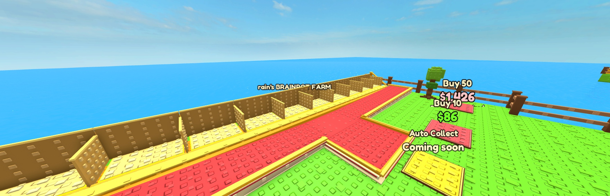

# Shelf geometry refactor

Moved row construction from WorldBuilder into `DisplayShelves.buildRow`. Back walls, divider sides, and front trim now use native stud surfaces instead of hundreds of separate tiny parts. The 15 raised plinth studs per bay remain physical geometry.

Each ten-bay row uses **221 parts**, down from **1,021** (78.4% fewer). At five rows on each of six farms, this removes **24,000 parts**. These are geometry counts, not an FPS claim.

All retained sizes, transforms, colors, materials and physics flags match the old generator. Thick stand tops, neon `SlotN` lookup/recoloring, trims and row spacing are unchanged. WorldBuilder retains scaling, parenting, yielding and render-generation cancellation.

The Studio fixture passed live-row and isolated five-row checks after synchronization. The following images use the same camera position and target. Both were visually inspected; native studs retain the brick pattern without the former small-part density.

Before:

After:

Luau compilation and Rojo build pass. Higher gameplay limits still require separate populated-scene testing.
