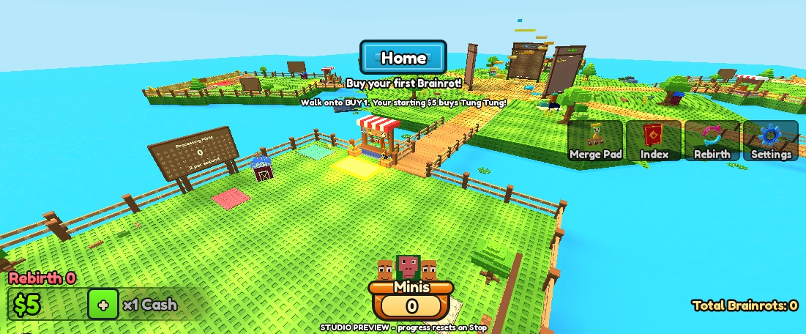
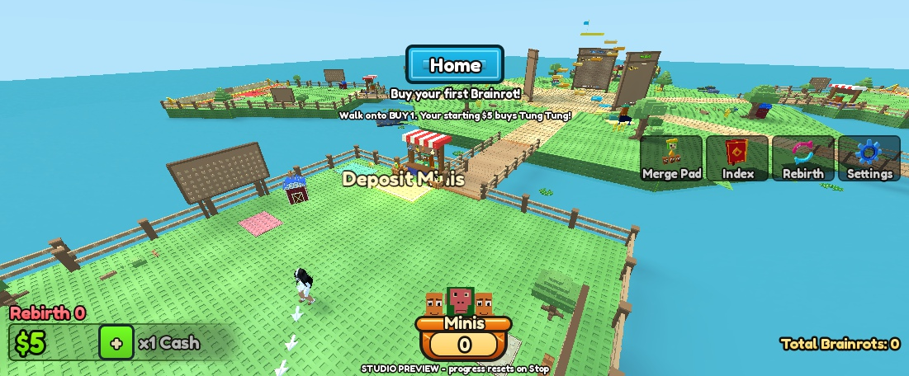
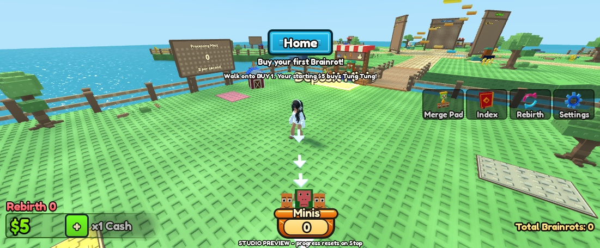

# Environment palette polish — October 20, 2026

This pass implements the supplied visual-polish brief in the Merge a Brainrot
project. It softens the environment while retaining its Blender-authored molded
detail, existing layout, paths and gameplay.

## Visible changes

- Ground: closely related moss and grass greens replace the fluorescent lime
  range. The authored top varies approximately RGB(117,175,85)–(136,194,100),
  with softer recess shading and restrained continuous patch variation.
- Island sides and foliage use related deeper greens. Gold paths and display
  surfaces use warmer sand colors. Bridge, fence and sign wood is less orange.
- Water uses RGB(58,139,150), tuned in Studio to render as balanced aqua. The
  suggested brighter swatch clipped toward cyan under Terrain lighting.
  Reflection is 0.04, wave size 0.08 and wave speed 5.
- Daytime brightness is 2; ambient light remains readable, with soft shadows.
  Added saturation and the warm global color cast are removed. Characters and
  UI retain their own palettes. The smooth gradient skybox remains unchanged.
- Ordinary pads retain green/red affordability meaning with softer colors.
  Merge stays gold and cash stays mint. Deposit lighting is reduced from 2.8
  to 0.65 brightness, with more transparent halos.

## Before and after

Both wide captures use camera `(30,31,177)` looking at `(0,1,132)` in separate
fresh Play sessions. Loading timing, water motion and avatar pose may differ.

Closer avatar-distance inspection:

## Verification

- Both Blender generators completed; authored normal, triangle and envelope
  checks passed. Twelve runtime templates changed only TextureID; their MeshIds,
  dimensions and collision properties are identical to the prior commit.
  See [asset audit](palette-geometry-audit.json).
- No extra map instances, lights, particles or runtime loops were introduced.
- 57 pure Luau suites passed. All 16 engine-mock CLI suites passed, including
  unchanged floor bounds/collision, bridge-related structure and pad behavior.
  The old ground-tint test required stronger contrast; it now checks a subtle
  nonzero range with an upper bound.
- All 90 shipped Luau files compiled. Rojo build passed.
- Native layout check passed: six plots and bridge interfaces, 48 conveyor
  lanes, 24 chutes, eight merchants, 12 clear decorations and six reference signs.
- Native shipped-controller walk flow passed: bought a producer, collected
  100 Minis, retained a held Lucky card during play, deposited, completed 75
  successful cash claims and upgraded the processor twice. See
  [native result](palette-native-flow.json).
- Independent review found no defects in the appearance-only changes.

The correct local MergeABrainrot-FirstPlayable place was saved after source
comparison. No live experience was published. Mobile-device performance and
published-experience asset permissions were not tested; existing Studio/plugin
analysis warnings remain outside this palette pass.
