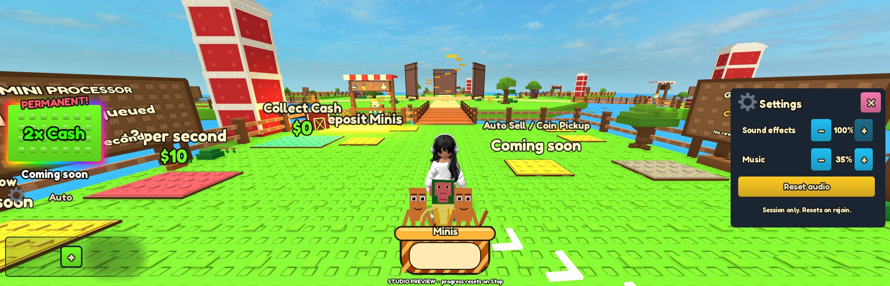

# Settings and audio integration

Implemented a compact nonmodal Settings panel with independent sound-effects and music volumes, 10% adjustment buttons, immediate mixer updates, reset, and accurate session-only copy. Escape closes Settings while preserving a held Lucky Block. Pad merges keep Settings open.

The Studio Settings fixture passed at eight viewport sizes from 320×480 and 600×280 through 1440×900. Checks covered panel/HUD bounds, scroll access, control separation, current values, group volumes, reset, subscription cleanup and held-Lucky restoration. Existing layout and audio fixtures also passed. The integrated audio lifecycle fixture confirmed actual playback advancement, bounded voice allocation, stop/start and cleanup.

Pure preference and preload-cache suites pass. Strict analysis passes for the pure preference/cache/config modules. Client modules and fixtures compile. Independent cross-review found and fixed an optional-type capture in the preload cache and the merge handler dismissing Settings.

Conveyor controllers now own and disconnect their tag subscriptions, clear model references, and destroy tier accents. The Studio lifecycle fixture passed repeated destruction, later tag events, and safe post-destroy updates. This supports repeatable performance trials without accumulating invisible controllers.

Settings are local to the current session; persistence is not implemented. The screenshot uses the production Settings view opened in a temporary HUD, removed after capture.
